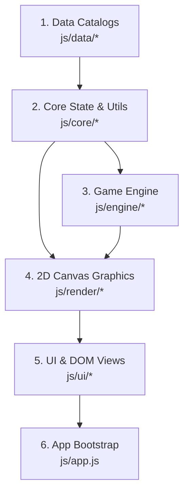

# 🐠 AquaVerse — Interactive Aquarium Builder & Lifecycle Simulator

AquaVerse là ứng dụng mô phỏng hồ thủy sinh tương tác cao chạy hoàn toàn trên nền tảng Web Canvas 2D và JavaScript nguyên bản (Vanilla JS), được cấu trúc theo mô hình kiến trúc phân tầng chuẩn (**5-Tier Clean Architecture**).

---

## 🏛️ Kiến Trúc Hệ Thống (Architecture Overview)

Dự án được phân tách từ file nguyên khối thành hệ thống 5 tầng chuyên biệt, độc lập và dễ mở rộng:



### 📁 Chi Tiết Các Tầng Thư Mục:

```
Aquarium/
├── css/
│   └── styles.css              # Glassmorphism, animations, custom scrollbars
├── js/
│   ├── data/                   # TẦNG 1: DỮ LIỆU CẤU HÌNH & TĨNH
│   │   ├── species.js          # Danh mục 10 loài cá, chỉ số sinh học, màu sắc
│   │   ├── morphs.js           # Hệ thống gen biến dị (Albinism, Golden,...)
│   │   ├── decorations.js      # Danh mục cây thủy sinh, san hô, đá phong thủy
│   │   ├── equipment.js        # Nâng cấp máy lọc, đèn LED, kích thước hồ
│   │   └── themes.js           # Bảng màu ánh sáng thủy sinh (LED Spectra)
│   │
│   ├── core/                   # TẦNG 2: TRẠNG THÁI & NỀN TẢNG
│   │   ├── state.js            # Đối tượng state toàn cục & biến môi trường
│   │   ├── utils.js            # Hàm toán học, clamp, format số, tạo ID ngẫu nhiên
│   │   ├── audio.js            # Web Audio API Synthesizer (tiếng bọt khí, tiếng nước)
│   │   └── save-system.js      # Lưu / Tải từ LocalStorage & cơ chế Auto-save
│   │
│   ├── engine/                 # TẦNG 3: VẬN HÀNH MÔ PHỎNG (DOMAIN LOGIC)
│   │   ├── entities.js         # Factory sinh thực thể cá, trứng cá, ốc sên
│   │   ├── simulation.js       # Vòng đời, đói, lớn lên, sinh sản, chất lượng nước
│   │   ├── physics.js          # Động lực học bơi lội, va chạm vách hồ, ma sát nước
│   │   └── food.js             # Rơi thức ăn, cá tìm mồi, chìm xuống đáy
│   │
│   ├── render/                 # TẦNG 4: ĐỒ HỌA CANVAS 2D
│   │   ├── canvas-bg.js        # Nền nước sâu, tia sáng caustics, đáy cát, sóng mặt
│   │   ├── canvas-decor.js     # Thực vật lay động, đá decor, ốc sên dọn đáy
│   │   ├── fish-renderer.js    # Vẽ giải phẫu cá (thân, vây, mắt, vảy, aura đột biến)
│   │   ├── vfx.js              # Hạt bong bóng, gợn sóng nước, văn bản nổi
│   │   └── renderer.js         # Pipeline điều phối vẽ chính theo thứ tự Z-index
│   │
│   ├── ui/                     # TẦNG 5: GIAO DIỆN & TƯƠNG TÁC NGƯỜI DÙNG
│   │   ├── ui-svgs.js          # Vector SVG minh họa hình ảnh loài cá & trang bị
│   │   ├── ui-hud.js           # Cập nhật thanh trạng thái (XP, Tiền, Cảnh báo nước)
│   │   ├── ui-drawer.js        # Bảng điều khiển hông (Shop, Cây, Đàn cá, Lai tạo)
│   │   ├── ui-modals.js        # Hộp thoại hướng dẫn, thành tựu, thông báo Toast
│   │   ├── inspector.js        # Bảng soi chi tiết cá thể (tên, gen, sức khỏe)
│   │   ├── interaction.js      # Sự kiện gõ kính, cho ăn, kéo thả decor
│   │   ├── shop.js             # Mua cá, mua nâng cấp, trang trí
│   │   ├── lab.js              # Lai tạo giống cá mới, chọn cá bố mẹ
│   │   └── settings.js         # Đổi chế độ sáng, reset hồ, xuất file
│   │
│   └── app.js                  # TẦNG 6: KHỞI TẠO VÀ VÒNG LẶP (GAME LOOP)
├── index.html                  # Giao diện HTML5 và nạp script theo tầng
├── package.json                # Quản lý lệnh dev & kiểm tra cú pháp AST
└── README.md                   # Tài liệu kiến trúc dự án
```

---

## 🚀 Hướng Dẫn Chạy & Phát Triển

### 1. Mở trực tiếp không cần cài đặt (Zero-Dependency)
Bạn có thể mở trực tiếp file `index.html` trong bất kỳ trình duyệt web hiện đại nào (Chrome, Edge, Firefox, Safari).

### 2. Chạy với Local Dev Server
```bash
# Nạp nhanh server tĩnh
npm start
# hoặc
npx serve .
```

### 3. Kiểm tra tính toàn vẹn cú pháp (AST Syntax Check)
Dự án có sẵn script kiểm tra cú pháp tự động toàn bộ 28 file JavaScript bằng Node.js:
```bash
npm run check
# hoặc
npm test
```

---

## 🧬 Hướng Dẫn Mở Rộng Mã Nguồn

### Thêm một loài cá mới
Mở file `js/data/species.js` và thêm định nghĩa cá thể vào `SPECIES_CATALOG`:
```javascript
my_new_fish: {
    id: 'my_new_fish',
    name: 'Tên Loài Cá',
    scientific: 'Scientific Name',
    rarity: 'Rare',
    rarityColor: 'text-purple-300 border-purple-500/40 bg-purple-500/15',
    swimZone: 'mid',
    eggCost: 150,
    juvenileCost: 350,
    sellBase: 250,
    coinRate: 8,
    unlockLevel: 4,
    bodyLength: 46,
    bodyHeight: 22,
    primaryColor: '#a855f7',
    secondaryColor: '#f43f5e',
    description: 'Mô tả tập tính sinh học của loài cá mới...'
}
```

### Thêm một chủ đề ánh sáng mới
Mở `js/data/themes.js` và bổ sung dải màu:
```javascript
{
    id: 'sunset_reef',
    name: 'Sunset Reef Glow',
    topGrad: '#4a044e',
    midGrad: '#701a75',
    botGrad: '#18181b',
    rayColor: 'rgba(244, 114, 182, 0.12)'
}
```

---

## 💾 Hệ Thống Lưu Trữ (Persistence)
- Dữ liệu game (cá thể, cấp độ, nâng cấp hồ, vị trí đồ trang trí) được tự động lưu vào trình duyệt thông qua `LocalStorage` (`aquaverse_save_v2`).
- Bạn có thể nhấn biểu tượng Cài đặt -> **Reset Tank** để xóa dữ liệu chơi lại từ đầu, hoặc **Download Standalone HTML** để xuất bản bản độc lập.
